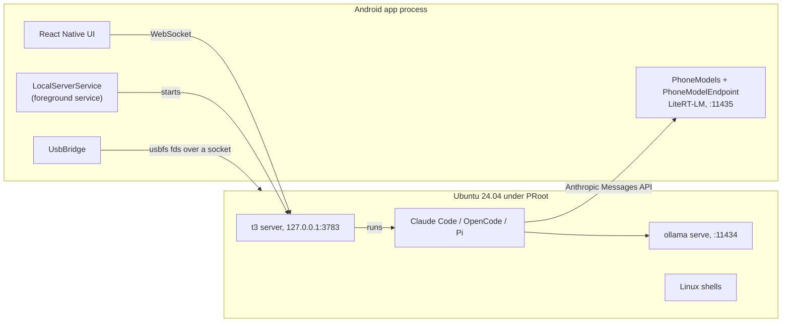

# T3² Code on Android: technical notes

These notes describe what T3² Code, developed in the t9-code repository, adds to the upstream T3 Code mobile app: the built-in server, the Linux environment, local models, and the release and update pipeline. They focus on decisions and traps the source does not make obvious. User-facing behavior is documented in [This phone](../user/this-phone.md).

Most of the native code lives in [`apps/mobile/modules/t3-local-server`](../../apps/mobile/modules/t3-local-server). The React side is under [`apps/mobile/src/features/local-server`](../../apps/mobile/src/features/local-server) and [`apps/mobile/src/features/settings`](../../apps/mobile/src/features/settings).

## Architecture



The app connects to the built-in server like any other T3 environment. Everything that crosses into Linux goes through `127.0.0.1` or an abstract socket, so nothing is exposed to the network.

## Linux environment

- **PRoot instead of root.** Apps that target API 29 or later cannot execute files from their data directory. PRoot and its loader therefore ship as native libraries (`libproot.so`, `libproot_loader.so` in `jniLibs`), and every guest binary is loaded through them. See [`GuestRuntime.kt`](../../apps/mobile/modules/t3-local-server/android/src/main/java/expo/modules/t3localserver/GuestRuntime.kt).
- **First run downloads, it does not bundle.** [`RuntimeInstaller.kt`](../../apps/mobile/modules/t3-local-server/android/src/main/java/expo/modules/t3localserver/RuntimeInstaller.kt) downloads Ubuntu Base and Node.js from pinned URLs and verifies them, then runs `npm install -g t3@<version>`. This keeps the APK small and lets Linux be reset without reinstalling the app.
- **The phone runs the published `t3` package, not this repository's server.** Changes to `apps/server` or `packages/*` do not reach the phone until a matching `t3` release is published and `T3_VERSION` is bumped. Fix phone-side behavior in the mobile app or the native module.
- **Agents are optional.** Linux setup installs only base tools and `t3`. Claude Code, OpenCode and Pi are installed on demand through [`NpmTool.kt`](../../apps/mobile/modules/t3-local-server/android/src/main/java/expo/modules/t3localserver/NpmTool.kt). Never assume `claude`, `opencode` or `pi` exists in Linux. Pi is installed with `--ignore-scripts`, as T3's Pi provider does.
- **The rootfs format is versioned.** `GuestRuntime.RUNTIME_VERSION` marks a finished install. Bump it only when an existing rootfs can no longer work.

## Built-in server

- [`LocalServerService`](../../apps/mobile/modules/t3-local-server/android/src/main/java/expo/modules/t3localserver/LocalServerService.kt) is a foreground service that starts `t3` with `--host 127.0.0.1` on port 3783. It reports readiness by watching the server's log for its listening line.
- The service holds a wake lock while the server runs. [`AutoStop.kt`](../../apps/mobile/modules/t3-local-server/android/src/main/java/expo/modules/t3localserver/AutoStop.kt) depends on this, because its timer runs on the main looper in the background.
- Requests sent to the server before the app connects fail with `EnvironmentRpcUnavailableError`. Any app-side sync, such as the text generation fallback in [`localModels.ts`](../../apps/mobile/src/features/local-server/localModels.ts), must retry instead of trying once.
- Thread titles default to Codex, which is not available on phones. The app switches the server's text generation setting to an installed provider.

## Local models

| Backend   | Where it runs                    | Port  | Reaches agents through             |
| --------- | -------------------------------- | ----- | ---------------------------------- |
| Phone GPU | The app process, using LiteRT-LM | 11435 | An Anthropic Messages API endpoint |
| Ollama    | Linux, as `ollama serve`         | 11434 | Ollama's Anthropic-compatible API  |

- **The GPU is out of reach from Linux**, because the guest cannot open the GPU driver. [`PhoneModels.kt`](../../apps/mobile/modules/t3-local-server/android/src/main/java/expo/modules/t3localserver/PhoneModels.kt) runs Gemma 4 inside the app, and [`PhoneModelEndpoint.kt`](../../apps/mobile/modules/t3-local-server/android/src/main/java/expo/modules/t3localserver/PhoneModelEndpoint.kt) serves it to Linux over `127.0.0.1`.
- **Both backends appear as Claude Code provider instances**, `claudeOllama` and `claudePhoneGpu`. They exist only while Claude Code is installed.
- **OpenCode and Pi get the same models** through `/root/.config/opencode/opencode.json` and `/root/.pi/agent/models.json`, as the providers `phone-ollama` and `phone-gpu`. Pi's Anthropic client appends `/v1/messages` itself, so its Phone GPU base URL has no `/v1`, and its GPU models declare a 24K context; otherwise Pi assumes 128K and never compacts. [`OpenCode.kt`](../../apps/mobile/modules/t3-local-server/android/src/main/java/expo/modules/t3localserver/OpenCode.kt) and [`Pi.kt`](../../apps/mobile/modules/t3-local-server/android/src/main/java/expo/modules/t3localserver/Pi.kt) keep those files in sync.
- **Keep LiteRT-LM at 0.16.1.** Version 0.17 and later are built with Kotlin 2.4, and the app uses Kotlin 2.2.
- **GPU only.** A CPU fallback used about 9.4 GB of memory and Android killed the app.
- **Gemma 4's chat template breaks replayed tool calls.** The endpoint sends tool results back as plain user text.

## Web server detection

Android hides `/proc/net` and `sock_diag` from apps, so the app cannot list listening sockets. Instead, a preload library ([`native/usb/t3usb_preload.c`](../../apps/mobile/modules/t3-local-server/native/usb)) reports each `listen()` call. [`DevServers.kt`](../../apps/mobile/modules/t3-local-server/android/src/main/java/expo/modules/t3localserver/DevServers.kt) then keeps the sockets that a guest process still holds. Statically linked programs bypass the preload library, so they are not detected. `opencode serve` is hidden from the list because it is part of the provider, not a user's server.

## USB

Apps cannot open `/dev/bus/usb`. [`UsbBridge.kt`](../../apps/mobile/modules/t3-local-server/android/src/main/java/expo/modules/t3localserver/UsbBridge.kt) asks Android for permission, then passes usbfs file descriptors to the guest over an abstract socket. It also maintains a fake sysfs and devfs tree of allowed devices, which the preload library uses to satisfy libusb and `adb`. Kernel drivers are out of reach, so serial adapters, storage and network devices do not become kernel devices.

## Backup and reset

- A backup is one gzip-compressed GNU tar: `t3-backup.json` first, then `rootfs/`. It is made from outside PRoot, so PRoot's `link2symlink` files, modes and symlinks restore exactly, even when Linux is broken.
- Restore unpacks next to the current environment and swaps it in with renames, so an interrupted restore can be finished or undone.
- Reset Linux keeps the paths in the `KEPT` list in [`LinuxBackup.kt`](../../apps/mobile/modules/t3-local-server/android/src/main/java/expo/modules/t3localserver/LinuxBackup.kt). When you add a user configuration directory, add it there too.

## Home screen widgets

The widgets live in [`t3-home-widgets`](../../apps/mobile/modules/t3-home-widgets). Their colors come from resources: `values-night` handles dark mode and `values-v31` uses the system's neutral palette and widget corner radius. The launcher inflates layouts in its own configuration, so XML colors follow the phone's light or dark mode. Gauge arcs, however, are bitmaps drawn in the app process, whose configuration can differ. Their track therefore uses one translucent grey (`t3w_track`) that reads on both cards. Never draw a theme color into a bitmap.

Transparent widgets use `t3w_clear_*` layouts that the module's [`build.gradle`](../../apps/mobile/modules/t3-home-widgets/android/build.gradle) generates from the card layouts by swapping styles, colors and backgrounds. Edit only the card layouts. A new style, color or background that a card layout uses needs a clear counterpart (`<Style>.Clear`) or a rule in that task.

## Releases and updates

### Build pipeline

Every push to `main` runs [`t9-android-release.yml`](../../.github/workflows/t9-android-release.yml):

1. It generates the Android project with `expo prebuild` using `APP_VARIANT=development` (package `com.t3tools.t3code.dev`) and `T3CODE_MOBILE_UPDATES_ENABLED=0`, so Expo's over-the-air updates are disabled.
2. It builds `app:assembleRelease` for `arm64-v8a` only.
3. It publishes a GitHub release tagged `b<versionCode>` with the asset `t9-code.apk`.

The `versionCode` is the build time in minutes since the Unix epoch ([`withAndroidBuildTimeVersionCode.cjs`](../../apps/mobile/plugins/withAndroidBuildTimeVersionCode.cjs)), so every build is newer than the last. All upstream workflows are disabled on this repository; most of them assume upstream runners and secrets.

### Package ID

The built app is `com.t3tools.t3code.dev`, the ID of upstream's development variant. Builds from 2026-11-10 used `io.github.iceman3d.t9code`, but Clerk (`clerk.t3.codes`, run by upstream) rejected social sign-in for it: the native sign-in returns to `clerk://<package>.callback`, and Clerk accepts only upstream's IDs there. Email sign-in worked either way. Android ties updates to the ID, so apps installed under the old ID cannot update to this one; their updater reports that the download is for another app, and users install the new APK by hand. Do not change the ID again. Because app.t3.codes verifies links only for upstream's signing key, links to `app.t3.codes/threads/...` are not verified for this app. Users approve the domain once in Android's **Open by default** settings; [This phone](../user/this-phone.md#opening-thread-links) has the steps.

### Signing

[`withAndroidReleaseSigning.cjs`](../../apps/mobile/plugins/withAndroidReleaseSigning.cjs) adds a release signing config that reads `T9_KEYSTORE_PATH`, `T9_KEYSTORE_PASSWORD`, `T9_KEY_ALIAS` and `T9_KEY_PASSWORD`. Without them, release builds fall back to the debug key. In CI, the keystore comes from the `ANDROID_KEYSTORE_BASE64` secret, and the build fails if that secret is missing.

> [!WARNING]
> Installed apps accept updates only when they are signed with the same key. If the release key is lost, no installed app can be updated again. Keep an offline backup of the keystore and its passwords.

### In-app updater

- [`apkUpdates.ts`](../../apps/mobile/src/features/updates/apkUpdates.ts) reads `releases/latest` from the GitHub API and compares the tag's `versionCode` with the installed one.
- [`ApkUpdates.tsx`](../../apps/mobile/src/features/updates/ApkUpdates.tsx) checks at most once a day on launch and from **Settings > About**.
- The native module [`t3-app-update`](../../apps/mobile/modules/t3-app-update) downloads the APK to the app cache. It refuses the file unless the package name matches and the `versionCode` is newer, then hands it to the system installer through a `FileProvider` URI. Android's signature check is the final gate.

## Building locally

You need [Vite+](https://viteplus.dev/guide/), JDK 17 and the Android SDK.

```bash
vp i
cp .env.example .env
cd apps/mobile
APP_VARIANT=development T3CODE_MOBILE_UPDATES_ENABLED=0 npx expo prebuild --clean --platform android
cd android && ./gradlew app:assembleRelease -PreactNativeArchitectures=arm64-v8a
```

The APK is written to `apps/mobile/android/app/build/outputs/apk/release/app-release.apk`. To sign it, set the `T9_*` variables first. A self-built APK and an official release are signed with different keys, so neither can update the other.

The `android/` directory is generated and ignored by git. Native configuration changes belong in the config plugins under [`apps/mobile/plugins`](../../apps/mobile/plugins), not in `android/`.

Before committing, run `vp run check:changed`.
